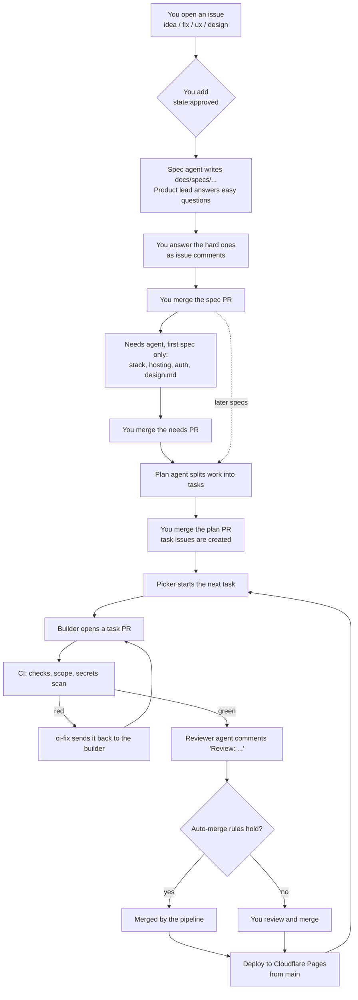

# agentic-sdlc: user manual

This plugin turns a GitHub repo into a small software team made of Claude agents. You write an issue, approve a few
pull requests, and the agents write the spec, the plan, the code, the tests and the review. Everything runs in GitHub
Actions; your laptop only installs and upgrades the files.

You stay in charge of three things: **what** gets built (you approve issues), **how** (you merge the spec and plan PRs),
and **anything risky** (agents stop and ask you, labelled `needs-you`).

---

## 1. What you need

| Thing | Why | Cost |
|---|---|---|
| A GitHub repo you own, with `gh` logged in (`gh auth status`) | The pipeline lives in issues, PRs and Actions | Free |
| Claude Code with this plugin installed | Runs the setup skills | Your Claude plan |
| `CLAUDE_CODE_OAUTH_TOKEN` repo secret (make it with `claude setup-token`) | The agents in Actions run on your Claude subscription | Your Claude plan |
| The Claude GitHub App installed on the repo | Agents comment and open PRs as `claude[bot]` | Free |
| Optional: Cloudflare Pages + `CLOUDFLARE_API_TOKEN`, `CLOUDFLARE_ACCOUNT_ID` secrets | Deploys `main` after checks pass | Free tier |
| Optional: your own GitHub App + `SDLC_APP_ID`, `SDLC_APP_PRIVATE_KEY` secrets | Lets small fixes merge themselves (auto-merge) | Free |
| Optional: Telegram bot + notification Worker (`/sdlc-notify-setup`) | Phone messages when you are needed | Free tier |

Install the plugin from this marketplace:

```
/plugin marketplace add <path-or-repo-of-this-marketplace>
/plugin install agentic-sdlc
```

Check it loaded with `/sdlc-doctor`.

---

## 2. Set up a project (once per repo)

1. Open Claude Code in the repo and run **`/sdlc-init`**. It asks for the project name and type
   (`web`, `mobile`, `claude-plugin`, `chrome-ext`), shows the files it will add, and waits for your yes.
   It never overwrites your files.
2. It creates the labels, an issue called **"SDLC control"** (the kill switch), and opens a PR on
   `chore/technical/sdlc-init`. **Review and merge that PR.**
3. Add the repo secrets from the table above (`gh secret set CLAUDE_CODE_OAUTH_TOKEN`, and so on).
4. Fill in `docs/constitution.md`: the goal, principles and quality bar. Agents read it before every decision.
   You can leave **Stack** empty; the needs step proposes it.
5. Turn it on: in `.sdlc/config.yml` set `dry_run: false` (it starts `true`, where agents only say what they would do).
   This file is protected, so change it through a PR.
6. Optional: `/sdlc-notify-setup` for Telegram, and say yes to branch protection when `/sdlc-init` offers it.

---

## 3. The flow



Step by step, with what **you** do in bold:

1. **Open an issue** with one of the templates (idea, fix, ux, design). It gets `state:proposed`.
2. **Approve it.** Two ways:
   - Add `state:approved`: the full route (spec, plan, tasks). Use it for features.
   - For a small `fix` or `ux` issue, remove `state:proposed` and add no other state label: the picker builds it
     directly as a single task, with no spec or plan.
3. **Spec.** The spec agent writes `docs/specs/<issue>-*.md` on a PR: summary, user stories, acceptance criteria,
   open questions. The product lead decides the routine questions. Critical ones (new paid service, data you
   cannot undo, security, product direction) come to you with `needs-you`. **Answer in a comment on the issue**;
   the spec is updated. **Merge the spec PR** when happy.
4. **Needs** (first spec only, when `needs.enabled: true`). Picks UI, database, hosting, auth, testing, with free-tier
   limits, and writes `docs/design.md`. **Merge the needs PR.**
5. **Plan.** Splits the spec into tasks and lists any gates (risky areas). **Merge the plan PR**; one issue per task appears.
6. **Build.** The picker (hourly, and after every push to `main`) starts one task at a time, highest priority first:
   `critical` > fix > ux > design > idea. The builder opens a task PR.
7. **CI and review.** CI runs checks, a scope check and a gitleaks secret scan. Red CI goes back to the builder
   automatically (up to `limits.retries`). Green CI gets an agent review.
8. **Merge.** If you want changes, comment **`/build <what to change>`** on the PR. Otherwise merge it.
   With `auto_merge.enabled: true`, a fix or UX task merges itself, but only when CI is green, the review found nothing
   blocking, no plan gate fired and no protected path was touched. Anything else waits for you, with the reason.
9. **Deploy.** A push to `main` that passes CI deploys to Cloudflare Pages (if `deploy.provider` is set). The monitor
   checks `deploy.health_url` every 30 minutes and flags `critical` if the site is down.

### Labels you will see

| Label | Meaning |
|---|---|
| `state:proposed` → `approved` → `specifying` → `spec-approved` → `planning` → `planned` | An issue on its way to tasks |
| `state:building` → `in-review` → `done` | A task on its way to `main` |
| `needs-you` | An agent is waiting for you. This is your to-do list |
| `state:blocked` | Stopped, needs a decision |
| `review:blocking` | The reviewer found something that must be fixed |
| `critical` | Broken `main`, failed deploy or a security problem. Jumps the queue |
| `PAUSE` | On the control issue only: everything stops |

A good daily habit: filter issues and PRs by `needs-you`.

---

## 4. Safety controls

- **Kill switch.** Add `PAUSE` to the "SDLC control" issue. Every workflow checks it before it starts. Only you can remove
  it; if anyone else does, it is put back. **`/sdlc-stop-all`** pauses every pipeline repo you own at once.
- **Dry run.** `dry_run: true` makes agents log what they would do without changing anything. Good for a first look.
- **Daily cap.** `limits.daily_runs` (default 20) agent runs per day. When it is used up the pipeline pauses until tomorrow.
- **One thing at a time.** `limits.active_items: 1`: one item is built at a time per repo.
- **Night window.** With `night_window.enabled: true`, non-critical builds only start between `start` and `end`
  (default 01:00-06:00 in your `timezone`), so the work happens while you sleep. Set `enabled: false` to build any time.
- **Protected paths.** `.github/`, `.sdlc/`, `docs/constitution.md`, migrations and `package.json` always need your
  review (CODEOWNERS).
- **Watchdog.** If anyone but you pushes to `main` without a merged PR, the pipeline pauses itself and opens a
  `critical` issue.
- **Only you trigger agents.** Approving labels, answers and `/build` comments count only when they come from the repo owner.

---

## 5. Day-to-day commands

| Command | Where | What it does |
|---|---|---|
| `/sdlc-init` | Claude Code, in the repo | Installs the pipeline (once) |
| `/sdlc-upgrade` | Claude Code, in the repo | Updates the pipeline files to the installed plugin version via a PR. Files you edited are kept unless you choose otherwise |
| `/sdlc-board` | Claude Code, in the repo | Opens a local metrics page: runs today vs. the cap, cost, turns, tokens, outcomes |
| `/sdlc-notify-setup` | Claude Code | Sets up Telegram notifications (service once, then one step per repo) |
| `/sdlc-stop-all` | Claude Code | Adds `PAUSE` to every pipeline repo you own |
| `/sdlc-doctor` | Claude Code | Checks the plugin is loaded |
| `/build <change>` | Comment on a task PR | Sends the PR back to the builder with your request |
| `gh workflow run sdlc-merge.yml -f pr=<n>` | Terminal | Re-checks one PR against the auto-merge rules |

Notifications, when set up: `needs-you` and `critical` arrive at once; everything else comes in one morning digest
(05:00 UTC).

---

## 6. Settings (`.sdlc/config.yml`)

| Setting | Default | Change it when |
|---|---|---|
| `dry_run` | `true` | You are ready for real runs |
| `product_lead` | `true` | You want to answer every spec question yourself (`false`) |
| `limits.daily_runs` | `20` | Busy days hit the cap |
| `limits.retries` | `2` | CI fixes give up too early or loop too long |
| `night_window` | on, 01:00-06:00 | You want builds during the day |
| `needs.enabled` | `true` | The stack is already decided |
| `auto_merge.enabled` | `false` | You trust the pipeline with small fixes (needs the GitHub App secrets) |
| `notify.url` | empty | Set by `/sdlc-notify-setup` |
| `deploy.*` | Cloudflare Pages, empty project | You want deploys; set `project`, `dir`, `health_url` |

Every change to this file goes through a PR, because it is a protected path.

---

## 7. When something goes wrong

- **Nothing happens after I add `state:approved`.** Check `PAUSE` on the control issue, `dry_run`, the daily cap
  (`/sdlc-board`), and that you (the owner) added the label. Then look at the Actions tab.
- **A task waits forever.** The picker builds one item at a time, and an item labelled `needs-you` or `state:blocked`
  holds the queue. Answer it.
- **Builds only run at night.** That is the night window. Set `night_window.enabled: false`.
- **A PR did not merge itself.** The merge bot left a comment saying why (auto-merge off, not a fix/UX task, gate fired,
  protected path, CI not green, blocking review).
- **CI keeps failing.** After `limits.retries` fixes the task gets `state:blocked` and `needs-you`. Fix it by hand or comment `/build <hint>`.
- **Upgrading.** The plugin changes nothing in your repo by itself. Run `/sdlc-upgrade` and merge its PR.
  See [CHANGELOG.md](CHANGELOG.md) for what each version changed.
